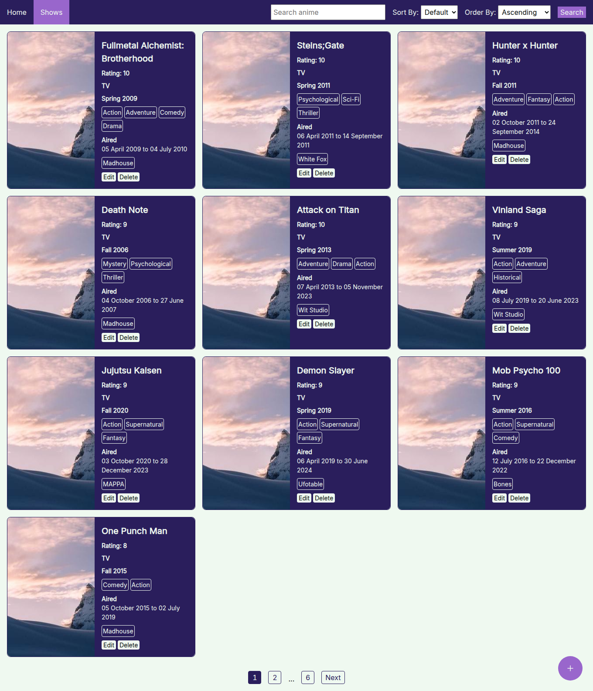

# Anime Library

- An app that shows information about anime show

## Features:

1. Adding anime show entry.
1. Editing anime entry.
1. Deleting anime entry.
1. Search anime
1. Filtering by type
1. Pagination

## Tools:

1. Node/Express
1. EJS
1. Postgres
1. HTML
1. CSS
1. argon2
1. Render
1. Neon

## Screenshot



```
├── app.js
├── controllers
│   └── showsController.js
├── db
│   ├── pool.js
│   ├── populatedb.js
│   └── queries.js
├── errors
│   └── errors.js
├── routes
│   └── showsRouter.js
├── utils.js
└── views
├── 404.ejs
├── add_show.ejs
├── delete_show.ejs
├── index.ejs
├── partials
│   ├── backBtn.ejs
│   ├── emptyShows.ejs
│   ├── errors.ejs
│   ├── formats.ejs
│   ├── genres.ejs
│   ├── navbar.ejs
│   ├── pagination.ejs
│   ├── password.ejs
│   ├── search.ejs
│   ├── showsList.ejs
│   └── studios.ejs
├── shows.ejs
└── update_show.ejs
```

## How to run

1. Clone the repository
1. `npm install`
1. `npm run start`
